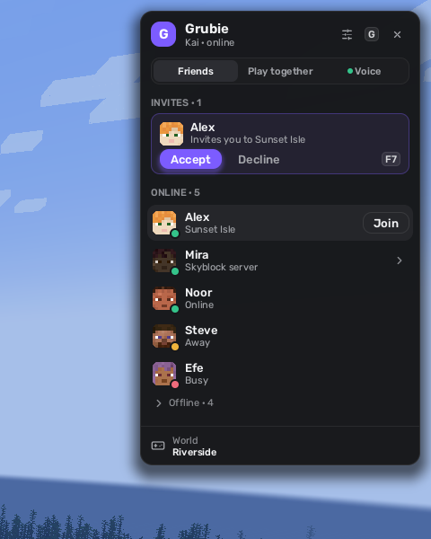
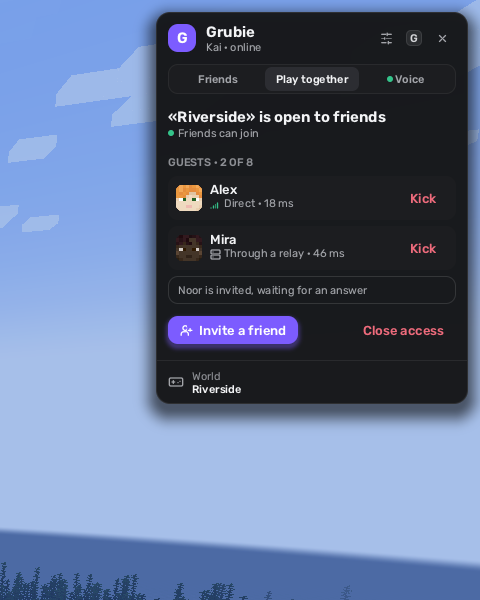
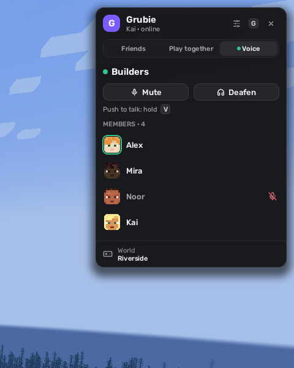
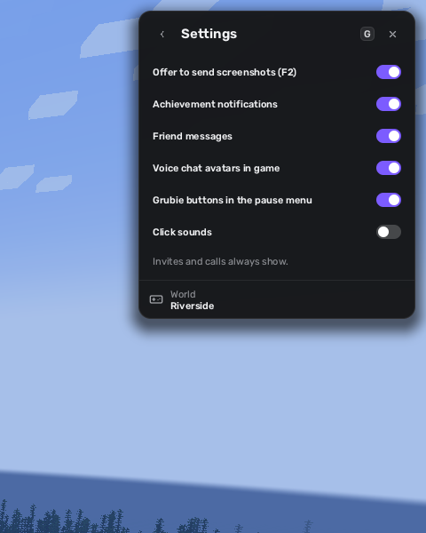
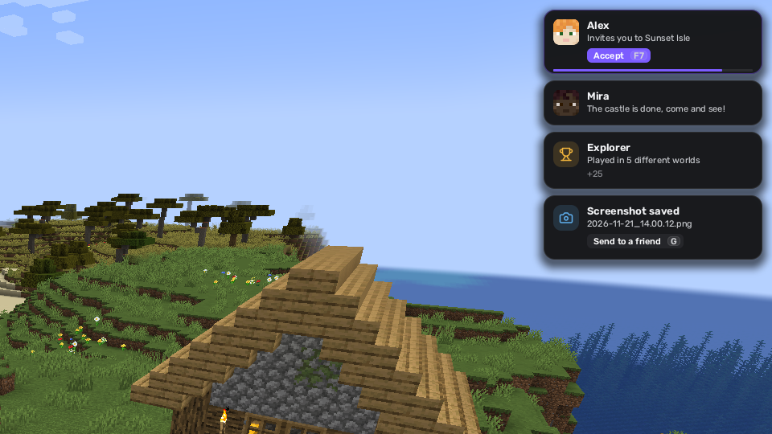
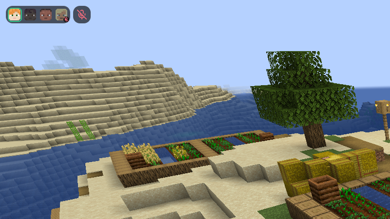
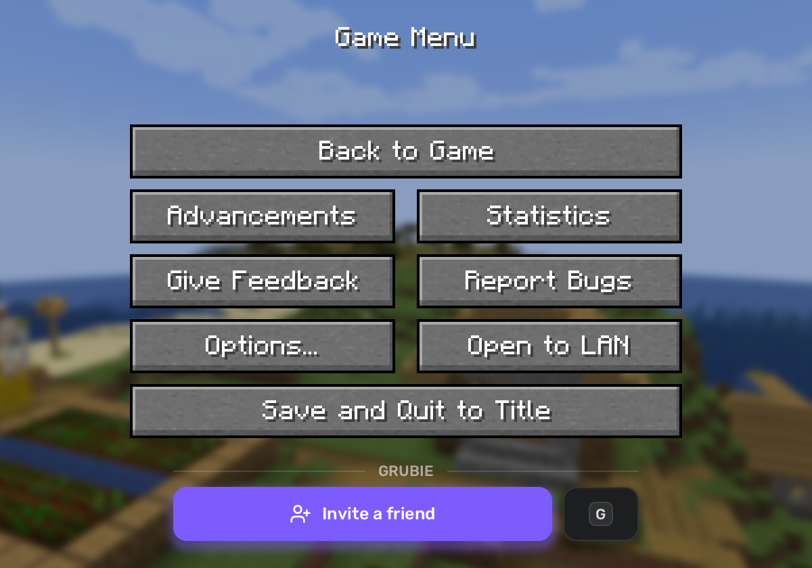
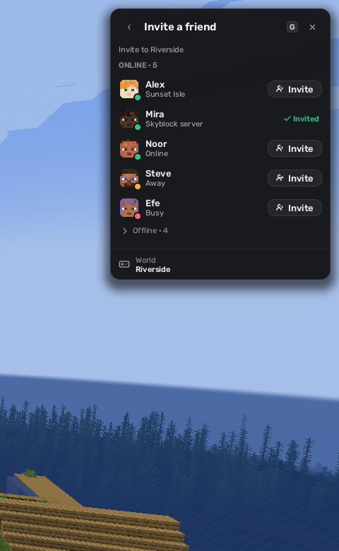
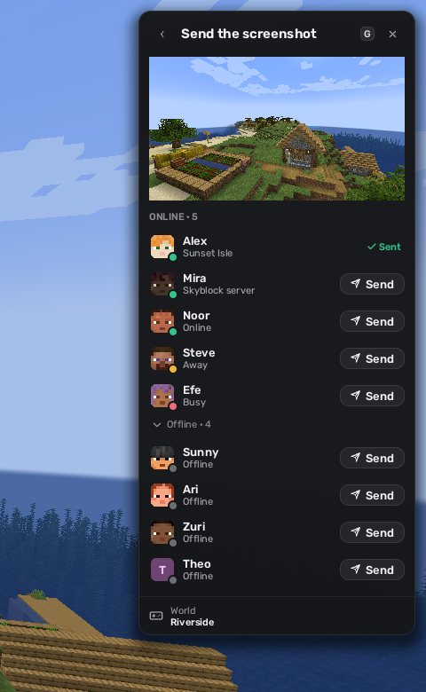

# Grubie Companion

Client mod for Grubie Launcher. It brings the launcher into the game:

- a friends panel on <kbd>G</kbd> (a drawer on the right): online friends, invites, Play Together hosting, voice chat;
- buttons under the pause menu: open the current world to friends, invite a friend to the current world or server;
- toasts: messages, invites (<kbd>F7</kbd> accepts), achievements the moment they unlock, a screenshot you just took with "send to a friend";
- who is talking in Grubie voice chat, your mute state and push-to-talk while the game has focus;
- the loading stage and, if the game freezes, the stack of the stuck thread with the mods it runs through, so the launcher can tell the player what hung;
- statistics from multiplayer servers and the current world, so launcher achievements count there too.

The interface is drawn by the mod itself (Rubik, the Grubie colours, rounded panels, shadows, animations) instead of the game's buttons and screens, and looks the same on every supported version.

Without the launcher the mod does nothing: it starts only when the game was launched with `GRUBIE_COMPANION_ADDRESS` and `GRUBIE_COMPANION_TOKEN` in the environment. Fabric API is not needed.

## Screenshots

**The friends panel on <kbd>G</kbd>: who is online, invites and Play Together hosting**

<p>
  
  
</p>

**Voice chat in the panel, and the mod's settings**

<p>
  
  
</p>

**Toasts: an invite (<kbd>F7</kbd> accepts), a message, an achievement and a screenshot you just took**



**Who is talking in Grubie voice chat, and your mute state**



**Grubie buttons under the pause menu**



**Invite a friend to your world, or send them the screenshot you took with <kbd>F2</kbd>, offline friends too**

<p>
  
  
</p>

## Supported versions

One jar per Minecraft line and loader. Quilt uses the Fabric jar. The Forge 1.20.1 jar also serves NeoForge 1.20.1.

| Line | Minecraft releases | Fabric | Forge | NeoForge | Java |
|---|---|---|---|---|---|
| 1.16.5 | 1.16.5 | ✓ | ✓ | — | 8 |
| 1.17.1 | 1.17, 1.17.1 | ✓ | ✓ | — | 16 |
| 1.18.2 | 1.18 – 1.18.2 | ✓ | ✓ | — | 17 |
| 1.19.2 | 1.19 – 1.19.2 | ✓ | ✓ | — | 17 |
| 1.19.4 | 1.19.3, 1.19.4 | ✓ | ✓ | — | 17 |
| 1.20.1 | 1.20, 1.20.1 | ✓ | ✓ | ✓ (Forge jar) | 17 |
| 1.20.4 | 1.20.2 – 1.20.4 | ✓ | ✓ | ✓ | 17 |
| 1.20.6 | 1.20.5, 1.20.6 | ✓ | ✓ | ✓ | 21 |
| 1.21.1 | 1.21, 1.21.1 | ✓ | ✓ | ✓ | 21 |
| 1.21.4 | 1.21.2 – 1.21.4 | ✓ | ✓ | ✓ | 21 |
| 1.21.5 | 1.21.5 | ✓ | ✓ | ✓ | 21 |
| 1.21.8 | 1.21.6 – 1.21.8 | ✓ | ✓ | ✓ | 21 |
| 1.21.10 | 1.21.9, 1.21.10 | ✓ | ✓ | ✓ | 21 |
| 1.21.11 | 1.21.11 | ✓ | ✓ | ✓ | 21 |
| 26.1.2 | 26.1 – 26.1.2 | ✓ | ✓ | ✓ | 25 |
| 26.2 | 26.2 | ✓ | ✓ | ✓ | 25 |
| 26.3 | 26.3 | ✓ | ✓ | ✓ | 25 |

The Runtime workflow starts every release a jar claims, on every loader that has a build for it, and fails the jar if the game crashes or the mod does not reach the world.

## Layout

The project uses [Stonecutter](https://stonecutter.kikugie.dev): one source tree, with version-specific lines behind `//? if` comments, built once per node (`versions/<line>-<loader>`).

- `core/` — plain Java without Minecraft: the launcher protocol and a small JSON reader/writer, the reconnecting socket, the state the launcher pushes, the statistics schedule and the snapshot file. Unit tests live here. It is compiled for Java 16 and copied into every jar.
- `src/main/java/.../render` — the drawing layer: `Gfx` (the only place that knows how a version draws), `Canvas` (rounded rectangles, borders and soft shadows made from textures generated at the exact pixel size), `Text` (Rubik through STB TrueType from the game's LWJGL, glyphs rasterised at the real pixel size), `Icons` (an atlas of Lucide icons at twelve sizes).
- `src/main/java/.../ui` — the panel, the pause buttons, toasts and the voice indicator, written once against `Canvas`.
- `src/main/java/.../mc/Mc.java` — the game calls that change between versions.
- `src/main/java/.../mixin` — hooks into vanilla classes, the same for every loader: client tick, options (key mappings), pause screen, the toast layer (which draws the overlay above everything), language loading (for Fabric without Fabric API).
- `src/main/java/.../loader/<loader>` — the loader entry points.
- `tools/IconAtlas.java` — regenerates `textures/icons.png` from Lucide path data: `java tools/IconAtlas.java src/main/resources/assets/grubie_companion/textures/icons.png`.

Toolchains: Fabric Loom (with remapping up to 1.21.11, without from 26.1), Architectury Loom for every Forge line (it remaps mixins to SRG on old Forge, so no refmap is needed), ModDevGradle for NeoForge, and JvmDowngrader for 1.16.5 (the code is compiled for Java 16 and lowered to Java 8 with the needed API stubs shaded into the jar).

## Building

JDK 25 runs Gradle.

```
./gradlew :core:test
./gradlew collectRelease                          # every jar into build/release/<version>/ with targets.json
./gradlew collectRelease -Pcompanion.only=fabric  # a part: a loader, a line (1.21.1) or a node (1.21.1-fabric)
./gradlew listNodes                               # the node list as JSON
```

The active version for the IDE is `1.21.1-fabric`; switch it with the Stonecutter IntelliJ plugin or `-Pcompanion.active=<node>`.

## CI

- **Build** — core tests and every jar, in four parallel groups, merged into one `companion-release` artifact (`build/release/<version>/`).
- **Runtime** — weekly and on demand: runs the real client headless ([mc-runtime-test](https://github.com/headlesshq/mc-runtime-test)) for each jar and release, with a stand-in launcher (`scripts/ci-bridge.py`) that sends friends, voice and toasts. The mod connects, renders the toasts and the voice indicator, opens the panel twice and reports `selftest`. The job fails if the game crashes or the mod never reports being in the world.
- **Watch Minecraft releases** — every six hours.
- **Release** — on a `v*` tag: builds everything and publishes a GitHub release with the jars and `targets.json`.

## New Minecraft versions

`scripts/watch-minecraft.mjs` compares Mojang's release list with the versions the nodes claim.

1. **A patch of a supported line** (for example 26.3.1): it is added to that node's `mod.releases`. The jar ranges already cover it.
2. **A new line** (for example 26.4): a node is added with the loaders that already have a build for it (Fabric meta, Forge promotions, NeoForge maven) and their newest versions. The Forge node gets its `versions/<line>-forge/gradle.properties`.
3. The workflow builds the new targets. If they compile, it opens a pull request `Support Minecraft <version>`. If they do not, it opens an issue with the compiler errors.

To finish a new line by hand: find what changed with `javap` on the remapped jar in `~/.gradle/caches/fabric-loom/minecraftMaven`, add `//? if >=<version>` branches (mostly in `Gfx`, `Mc`, `PanelScreen`, `GrubieButton` and the mixins), run the Runtime workflow on the branch, merge, then release.

## Releasing

A `v<version>` tag builds every jar and publishes them in a GitHub release. A published release never changes: a fix is a new version. Grubie Launcher does not bundle the mod: it downloads the jar for the instance's version and loader from the Grubie servers and checks it against a signed list before the game starts.

## Protocol

[docs/PROTOCOL.md](docs/PROTOCOL.md).

## Licenses

GPL-3.0-only. The jar also carries [Rubik](https://github.com/googlefonts/rubik) (SIL Open Font License 1.1, `assets/grubie_companion/font/ofl.txt`) and icons from [Lucide](https://lucide.dev) (ISC, `assets/grubie_companion/textures/license-lucide.txt`).
